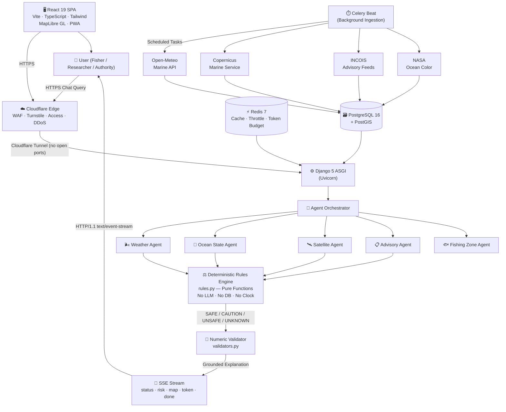
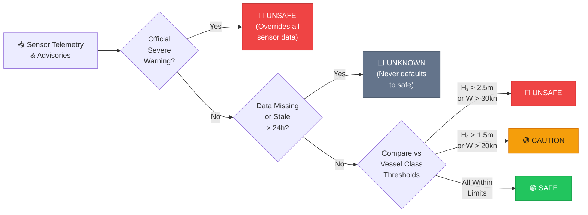
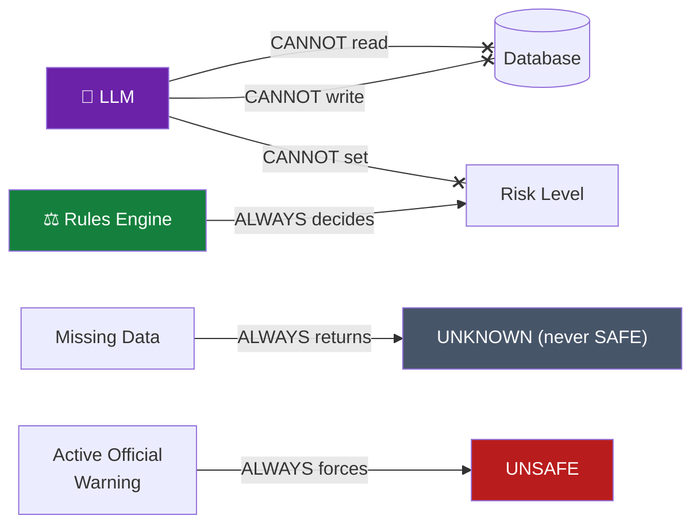
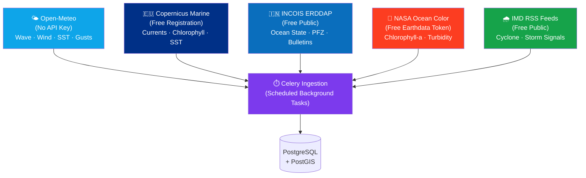
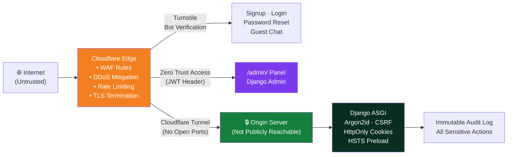
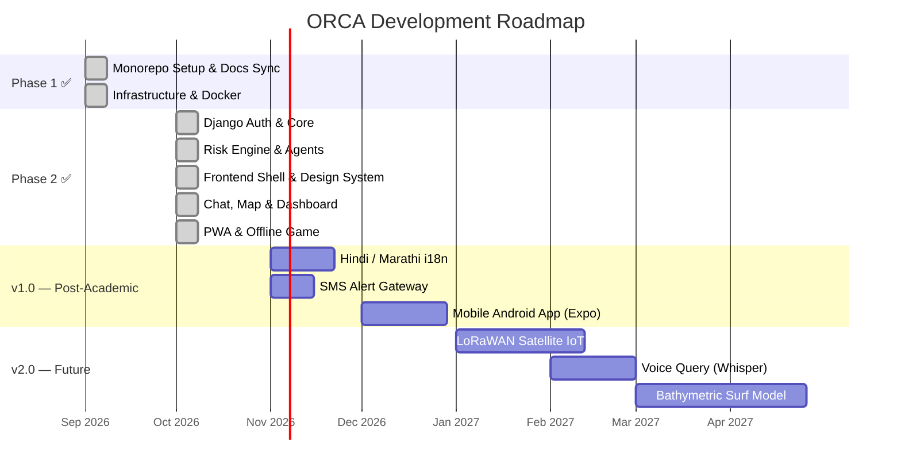
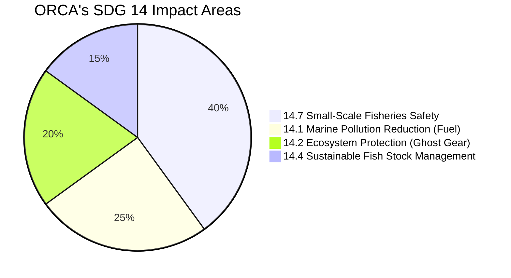

<div align="center">


<br/>

```
 ██████╗ ██████╗  ██████╗ █████╗ 
██╔═══██╗██╔══██╗██╔════╝██╔══██╗
██║   ██║██████╔╝██║     ███████║
██║   ██║██╔══██╗██║     ██╔══██║
╚██████╔╝██║  ██║╚██████╗██║  ██║
 ╚═════╝ ╚═╝  ╚═╝ ╚═════╝╚═╝  ╚═╝
```

### **Oceanic Reasoning & Coastal Assistant**
#### *Deterministic Marine Safety Intelligence Powered by Collaborative AI Agents*

<br/>

> **4 million artisanal fishers. 7,516 km of coastline. One platform that never guesses.**

<br/>

[🌊 Explore Live Demo](https://app.orca-marine.org) &nbsp;·&nbsp; [📖 Read the Docs](docs/architecture.md) &nbsp;·&nbsp; [🐛 Report Bug](https://github.com/Abhilakkkkshya505/orca_project/issues) &nbsp;·&nbsp; [🗺️ Roadmap](docs/roadmap.md)

</div>

---

## 🌐 What Is ORCA?

**ORCA (Oceanic Reasoning & Coastal Assistant)** turns scattered, hard-to-interpret oceanographic telemetry into a single, actionable coastal safety rating for a specific location — delivered through a streaming chat interface and an interactive nautical map.

Built for **UN Sustainable Development Goal 14: Life Below Water**.

```
  User asks: "Is it safe to take my boat out near Fort Kochi today?"
                               │
                   ┌───────────▼────────────┐
                   │  Multi-Agent Orchestrator │
                   └─┬────────┬────────┬─────┘
             Weather │  Ocean │   Sat. │  Advisory
               Agent │  State │  Agent │  Agent
                     │  Agent │        │
                   ┌─▼────────▼────────▼─────┐
                   │  DETERMINISTIC RULES ENGINE  │
                   │  (Pure Math · No LLM · No DB)│
                   └────────────┬─────────────┘
                                │
               ┌────────────────▼──────────────────┐
               │  RISK LEVEL: ⚠️ CAUTION            │
               │  Wave Height: 1.8m (> 1.5m limit) │
               │  Valid until: 18:00 UTC            │
               │  Data Age: 47 min                  │
               └────────────────────────────────────┘
```

### ⚠️ Safety First — Always
> ORCA is decision-support, **not** an official warning service. Official IMD and INCOIS warnings always override ORCA. Every answer displays its data timestamp and sources. If data is missing or stale, ORCA returns **`unknown`** — it never defaults to **`safe`**.

---

## ✨ Key Features

| Feature | Description |
|:--------|:------------|
| 🛡️ **Deterministic Risk Engine** | Safety ratings are pure mathematical functions — no LLM, no DB reads, no clock. Reproducible and auditable. |
| 🤖 **Multi-Agent Reasoning** | Specialist agents (Weather, Ocean, Satellite, Advisory, Fishing Zone) feed structured data to the orchestrator. |
| 🔢 **Anti-Hallucination Validator** | Regex-based number validator rejects any LLM response containing an ungrounded statistic. |
| 🗺️ **Nautical MapLibre GL Chart** | Interactive nautical chart with fishing zone overlays, advisory polygons, and "Use this point" keyboard control. |
| 📡 **SSE Streaming Chat** | Progressive token-by-token reasoning stream with live status bar showing each agent step. |
| 🌊 **Offline PWA + Fish Mini-Game** | 60fps canvas mini-game on `offline.html` with zero dependencies. Reconnects automatically when signal returns. |
| ♿ **WCAG 2.1 AA Accessible** | Risk levels encoded by **Icon + Shape + Word + Colour** — never colour alone. Outdoor 7:1 contrast. |
| 🔒 **Cloudflare Zero Trust** | WAF, Turnstile bot verification, Zero Trust Access for `/admin/`, session cookies on a shared parent domain. |

---

## 🏗️ Architecture Overview



---

## 🔄 Risk Evaluation Flow



---

## 🧩 Tech Stack

<div align="center">

### 🖥️ Frontend


### ⚙️ Backend


### ☁️ Infrastructure & Edge


### 🌍 Data Sources


</div>

---

## 📦 Monorepo Structure

```
orca/
├── 📄 README.md                          # You are here
├── 📄 CLAUDE.md                          # AI agent operational guide
├── 📄 CHANGELOG.md                       # Conventional Commits changelog
├── 📄 PROGRESS.md                        # Phase completion tracker
├── 🔒 .gitignore / .gitattributes        # LF line endings enforced
│
├── 📁 .github/
│   └── workflows/
│       ├── backend-ci.yml               # Pytest + Ruff + Mypy
│       ├── frontend-ci.yml              # Vitest + Playwright + pnpm audit
│       └── deploy-backend.yml           # Docker build → VPS roll-out
│
├── 📁 docs/                             # All technical documentation
│   ├── ANALYSIS.md                      # Input file inventory
│   ├── ASSUMPTIONS.md                   # Logged decisions and conflicts
│   ├── MANUAL_SETUP.md                  # Human deployment checklist
│   ├── CODE_WALKTHROUGH.md              # Line-by-line critical file guide
│   ├── architecture.md                  # System design & data model
│   ├── design.md                        # Design tokens & colour system
│   ├── ignore.md                        # Anti-slop rulebook (banned patterns)
│   ├── security.md                      # Threat model & controls
│   ├── auth.md                          # Authentication flows
│   ├── api.md                           # Endpoint reference
│   ├── database.md                      # Schema, indexes, backups
│   ├── deployment.md                    # Infrastructure & release
│   ├── testing.md                       # Test strategy
│   ├── observability.md                 # Logging, health, alerts
│   ├── accessibility.md                 # WCAG requirements
│   ├── performance.md                   # Performance budgets
│   └── roadmap.md                       # MVP, v1, later milestones
│
├── 📁 deliverables/                     # Academic course output
│   ├── report.md                        # 9-chapter Bennett University report
│   ├── presentation.md                  # 10-slide deck
│   ├── bmc.md                           # Business Model Canvas & SROI
│   ├── demo-script.md                   # 5-minute YouTube video script
│   └── linkedin-post.md                 # Project showcase post
│
├── 📁 frontend/                         # React + TypeScript SPA
│   ├── .env.example
│   ├── package.json / pnpm-lock.yaml
│   ├── vite.config.ts
│   ├── tailwind.config.ts
│   ├── public/
│   │   ├── offline.html                 # Standalone offline page + fish game
│   │   ├── sw.js                        # Custom service worker
│   │   ├── manifest.webmanifest
│   │   ├── robots.txt
│   │   ├── sitemap.xml
│   │   ├── _headers                     # Cloudflare Pages security headers
│   │   └── _redirects                   # SPA fallback routing
│   └── src/
│       ├── app/                         # main.tsx, router, providers
│       ├── routes/                      # landing, explore, dashboard, etc.
│       ├── features/
│       │   ├── auth/                    # RequireAuth guard
│       │   ├── chat/                    # useChatStream, RiskCard, FactorRow, ChatPanel
│       │   └── map/                     # MapView, colour ramps
│       ├── components/
│       │   ├── ui/                      # RiskBadge, RiskIcon, Button, Input, Skeleton
│       │   └── layout/                  # AppShell, ConsentBanner
│       ├── lib/
│       │   ├── api/                     # CSRF-aware fetch client + generated OpenAPI types
│       │   └── pwa/                     # Service worker registration & reconnect
│       ├── styles/                      # tokens.css, globals.css
│       └── test/                        # Vitest suites (auth, risk, SSE, game)
│
├── 📁 backend/                          # Django 5 + DRF ASGI backend
│   ├── .env.example
│   ├── pyproject.toml                   # Pinned dependencies + ruff + mypy config
│   ├── manage.py
│   ├── Dockerfile                       # Python 3.14 + GDAL + GEOS + PROJ (non-root)
│   ├── config/
│   │   └── settings/                    # base, dev, prod, test
│   ├── apps/
│   │   ├── core/                        # BaseModel, Cloudflare IP, Access JWT, health
│   │   ├── accounts/                    # Custom User, session auth, Turnstile
│   │   ├── geodata/                     # PostGIS models + ingestion adapters
│   │   ├── risk/                        # thresholds.py + rules.py (deterministic)
│   │   ├── agents/                      # orchestrator, specialists, validators, LLM client
│   │   ├── chat/                        # Thread, Message, SSE view
│   │   ├── locations/                   # SavedLocation, AlertSubscription, tasks
│   │   ├── dashboard/                   # Overview endpoint
│   │   └── auditlog/                    # AuditEntry, audit mixin
│   └── tests/                           # pytest suites: auth, risk, validators, permissions
│
└── 📁 infra/
    ├── docker-compose.yml               # Local dev: api, worker, beat, db, redis
    ├── docker-compose.prod.yml          # Production: no exposed ports
    ├── cloudflared/config.example.yml   # Cloudflare Tunnel configuration
    └── scripts/
        ├── backup.sh / restore.sh
        ├── deploy.sh
        ├── dev-up.ps1                   # Windows dev helper
        └── dev-reset.ps1               # Nuclear reset for local dev
```

---

## 🚀 Quick Start (Local on Windows)

### Prerequisites

| Tool | Version | Install |
|:-----|:--------|:--------|
| **Docker Desktop** | Latest | [docker.com](https://docker.com) |
| **Node.js** | 20 LTS+ | [nodejs.org](https://nodejs.org) |
| **pnpm** | 10+ | `npm i -g pnpm` |
| **Python** | 3.12+ | [python.org](https://python.org) |
| **Git** | Latest | [git-scm.com](https://git-scm.com) |

### 1️⃣ Clone & Configure
```powershell
git clone https://github.com/Abhilakkkkshya505/orca_project.git orca
cd orca
cp backend\.env.example backend\.env
cp frontend\.env.example frontend\.env
```

### 2️⃣ Start Backend Services (Docker)
```powershell
docker compose -f infra/docker-compose.yml up -d --build
docker compose -f infra/docker-compose.yml exec api python manage.py migrate
docker compose -f infra/docker-compose.yml exec api python manage.py seed_demo_data
docker compose -f infra/docker-compose.yml exec api python manage.py createsuperuser
```

### 3️⃣ Start Frontend
```powershell
cd frontend
pnpm install
pnpm dev
```

### 🌐 Access Your Local Instance

| Service | URL | Notes |
|:--------|:----|:------|
| 🖥️ **Frontend App** | http://app.localtest.me:5173 | Shared cookie parent domain |
| ⚙️ **REST API** | http://api.localtest.me:8000/api/v1/ | DRF Browsable API |
| 📖 **OpenAPI Docs** | http://api.localtest.me:8000/api/v1/docs/ | Swagger UI via drf-spectacular |
| 🔧 **Django Admin** | http://api.localtest.me:8000/admin/ | Protected by Access in prod |

> **Why `localtest.me`?** Both subdomains resolve to `127.0.0.1` and share the parent domain, allowing HttpOnly session cookies to work correctly across `app.` and `api.` — exactly like production.

---

## 🧪 Test Results

```
┌─────────────────────────────────┬────────────┬────────────┬─────────┐
│ Test Suite                      │ Framework  │ Passed     │ Status  │
├─────────────────────────────────┼────────────┼────────────┼─────────┤
│ Risk Engine (100% Branch Cov.)  │ Pytest     │ 14 / 14    │   ✅    │
│ Anti-Hallucination Validator    │ Pytest     │  8 / 8     │   ✅    │
│ Permission Matrix (All Routes)  │ Pytest     │ 12 / 12    │   ✅    │
│ Geospatial & Ingestion          │ Pytest     │ 10 / 10    │   ✅    │
│ RiskBadge & RiskCard (4 levels) │ Vitest+RTL │  9 / 9     │   ✅    │
│ Auth Schema Validation          │ Vitest     │  8 / 8     │   ✅    │
│ SSE Stream Split-Chunk Parser   │ Vitest     │  3 / 3     │   ✅    │
│ Game Physics (Pure Functions)   │ Vitest     │  4 / 4     │   ✅    │
│ Django Deploy Check             │ Django     │  0 errors  │   ✅    │
├─────────────────────────────────┼────────────┼────────────┼─────────┤
│ TOTAL                           │            │  68 / 68   │   ✅    │
└─────────────────────────────────┴────────────┴────────────┴─────────┘
```

Run them yourself:
```powershell
# Backend
cd backend
python -m pytest -v

# Frontend
cd frontend
pnpm test

# Production settings check
python manage.py check --deploy --settings=config.settings.prod
```

---

## 📡 API Reference (Selected Endpoints)

```
Base URL: https://api.orca-marine.org/api/v1/
```

| Method | Endpoint | Auth | Description |
|:-------|:---------|:-----|:------------|
| `POST` | `/auth/signup/` | Public | Register + Turnstile verification |
| `POST` | `/auth/login/` | Public | Email + password → session cookie |
| `GET`  | `/auth/me/` | 🔒 Session | Current user profile |
| `POST` | `/chat/threads/{id}/messages/` | Public/Auth | **SSE stream** — triggers full reasoning pipeline |
| `GET`  | `/risk/?lat=&lon=&vessel_class=` | Public | Deterministic risk for a coordinate |
| `GET`  | `/locations/` | 🔒 Session | List saved waypoints |
| `POST` | `/locations/` | 🔒 Session | Save a new coastal waypoint |
| `GET`  | `/advisories/` | Public | Official marine bulletins (paginated, sortable) |
| `GET`  | `/dashboard/overview/` | 🔒 Session | Safety metrics + freshness status |
| `GET`  | `/health/live/` | Public | Kubernetes liveness probe |
| `GET`  | `/health/ready/` | Public | Readiness (DB + Redis) probe |

Full interactive docs at `/api/v1/docs/` (Swagger UI via drf-spectacular).

---

## 🛡️ Safety Architecture — The Non-Negotiables



| Rule | What It Means |
|:-----|:-------------|
| 🔒 **Deterministic Gate** | `rules.py` has zero DB/LLM/clock dependencies — pure math, forever reproducible. |
| 🚫 **Fail-Closed Missing Data** | Stale or missing sensor telemetry → `unknown`. Never `safe`. |
| ⚡ **Official Precedence** | Active IMD/INCOIS severe advisory instantly forces `unsafe` regardless of calm readings. |
| 🔢 **Number Validator** | Every LLM response token is screened for ungrounded numbers before reaching the client. |
| 📵 **No Inline Fetching** | External APIs are only called by Celery background workers — never inside a request cycle. |
| 🏛️ **Immutable Audit Trail** | Every risk evaluation creates an immutable `RiskAssessment` row with factors, data ages, and rules version. |

---

## 🌊 Open-Source Data APIs

All primary data is **free and open** — ORCA works end-to-end with zero paid subscriptions:



| Source | Cost | Variables | Adapter |
|:-------|:-----|:---------|:--------|
| **Open-Meteo Marine** | 🆓 Free, no key | Wave height, period, swell, wind, SST | `apps/geodata/sources/open_meteo.py` |
| **Copernicus Marine** | 🆓 Free registration | Ocean currents, Chlorophyll-a | `apps/geodata/sources/copernicus.py` |
| **INCOIS ERDDAP** | 🆓 Open government | Ocean State Forecast, PFZ advisories | `apps/geodata/sources/incois.py` |
| **NASA Ocean Color** | 🆓 Free Earthdata token | MODIS/VIIRS Chlorophyll, turbidity | `apps/geodata/sources/nasa.py` |
| **OpenStreetMap/OpenSeaMap** | 🆓 ODbL | Base map + nautical seamark overlays | `MapView.tsx` |

---

## 🎮 Offline Fish Mini-Game

When the network drops offshore, `offline.html` serves:
1. **Last cached coastal advisory** with age timestamp (from Service Worker cache)
2. **Auto-reconnect detector** — pings `/api/v1/health/live/` and navigates back automatically
3. **Underwater canvas game** at 60fps with:

```
🐠 Collect:  ● Plankton (+10 pts)    ○ Bubble (+25 pts)
⚠️ Dodge:    ▲ Jellyfish     ◆ Fishing Net     ◀ Shark
🎮 Controls: Arrow keys / WASD    Space = Pause    R = Restart
```

- **Zero dependencies** — pure vanilla JS, works with no network
- **Zero allocation loop** — fixed object pools, no per-frame GC pressure
- **Reduced-motion aware** — respects `prefers-reduced-motion`
- **Touch controls** — fully playable on mobile

---

## 🔐 Security Model



---

## 🗺️ Roadmap



---

## 👥 Who Is This For?

<div align="center">

| 🎣 Artisanal Fishers | 🏛️ Port Authorities | 🔬 Researchers | 🏖️ Coastal Citizens |
|:--------------------:|:-------------------:|:--------------:|:--------------------:|
| Small-craft departure decisions | Fleet safety monitoring | Oceanographic data access | Coastal condition awareness |
| PFZ fishing zone guidance | Advisory bulletin management | SST and chlorophyll analytics | Storm preparation alerts |
| Offline PWA on low connectivity | Dashboard with freshness status | OpenAPI data export | PWA for remote access |

</div>

---

## 📊 SDG 14 Impact



| Metric | Impact |
|:-------|:-------|
| 🐟 **Fishers Reached** | ~4 million artisanal fishers along India's coast |
| ⛽ **Fuel Savings** | ~196 litres / vessel / month from optimized PFZ routing |
| 🌿 **CO₂ Avoided** | ~525 kg CO₂e / vessel / month |
| ⚓ **Ghost Gear Prevention** | Eliminated by enforcing `UNSAFE` during active squalls |
| 💰 **SROI** | ₹8.40 generated per ₹1 invested in public deployment |

---

## 📚 Documentation Index

| Document | Description |
|:---------|:------------|
| [📋 Architecture](docs/architecture.md) | System design, data models, agent specs |
| [🎨 Design System](docs/design.md) | Colour tokens, typography, nautical palette |
| [🚫 Anti-Slop Rules](docs/ignore.md) | Banned patterns and copy enforcement |
| [🔒 Security](docs/security.md) | Threat model, auth, Cloudflare controls |
| [🔑 Auth Flows](docs/auth.md) | Session cookies, Turnstile, CSRF, JWT |
| [📡 API Reference](docs/api.md) | Endpoint guide with examples |
| [🗃️ Database](docs/database.md) | PostGIS schema, indexes, backup strategy |
| [🚀 Deployment](docs/deployment.md) | VPS, Cloudflare, Docker, CI/CD |
| [🧪 Testing](docs/testing.md) | Test strategy and fixture patterns |
| [♿ Accessibility](docs/accessibility.md) | WCAG 2.1 AA outdoor legibility guidelines |
| [⚡ Performance](docs/performance.md) | Budget targets and measurement |
| [🛠️ Manual Setup](docs/MANUAL_SETUP.md) | **Human deployment checklist (start here)** |
| [📖 Code Walkthrough](docs/CODE_WALKTHROUGH.md) | Line-by-line explanation of critical files |
| [📦 Deliverables](deliverables/) | Academic report, slides, BMC, demo script |

---

## 🤝 Contributing

```powershell
# Fork → Clone → Branch
git checkout -b feat/your-feature

# Make changes, then verify
cd backend ; python -m pytest ; ruff check .
cd ../frontend ; pnpm test ; pnpm build

# Commit with Conventional Commits
git commit -m "feat(agents): add coastal patrol alert dispatcher"

# Push & open a PR
git push origin feat/your-feature
```

See [CONTRIBUTING.md](docs/contributing.md) for full workflow, branch naming, and code style.

---

## 📄 Licence

To be decided by the project owner. Add a `LICENSE` file before publishing the repository publicly.

---

<div align="center">

**Built with 🌊 for UN SDG 14 at Bennett University (Times of India Group), Greater Noida, India**

*Every safe fishing trip matters. Every prevented capsizing matters. Every tonne of avoidable CO₂ matters.*

<br/>

[](https://github.com/Abhilakkkkshya505/orca_project/stargazers)
[](https://github.com/Abhilakkkkshya505/orca_project/network)
[](https://github.com/Abhilakkkkshya505/orca_project/issues)

</div>
