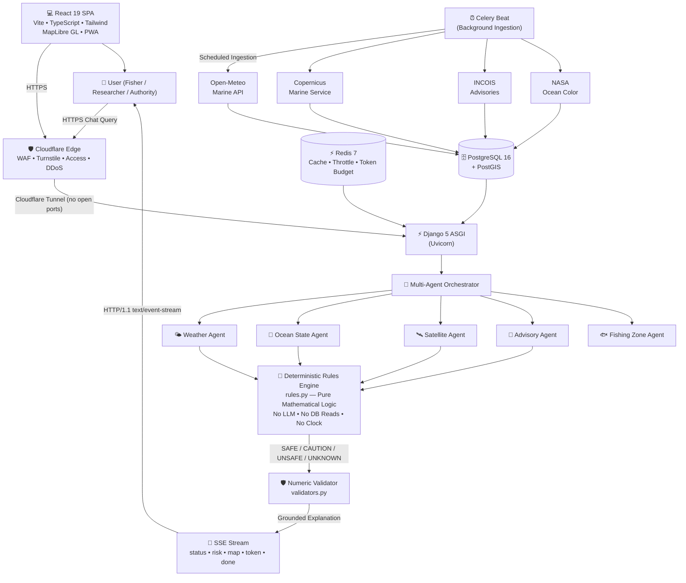
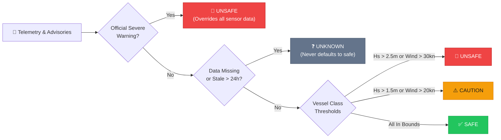

# ORCA — Oceanic Reasoning & Coastal Assistant
### Deterministic Marine Safety Intelligence Powered by Collaborative AI Agents

<div align="center">


<br/>

```
  ___  ____   ____    _   
 / _ \|  _ \ / ___|  / \  
| | | | |_) | |     / _ \ 
| |_| |  _ <| |___ / ___ \
 \___/|_| \_\\____/_/   \_\
```

#### *Real-Time Coastal Risk Assessment • 3,875+ World Ports • WMO Douglas Sea Scale Physics*

> **4 million artisanal fishers. 7,516 km of coastline. One platform that never guesses.**

[Explore Live Demo](https://app.orca-marine.org) • [Architecture Guide](docs/architecture.md) • [Report Issue](https://github.com/Abhilakkkkshya505/orca_project/issues) • [Development Roadmap](docs/roadmap.md)

</div>

---

## 🌊 What Is ORCA?

**ORCA (Oceanic Reasoning & Coastal Assistant)** converts complex, scattered oceanographic telemetry into clear, auditable coastal safety ratings for any port or marine coordinates.

Built specifically in support of **UN Sustainable Development Goal 14: Life Below Water**, ORCA is designed for artisanal fishers, port operators, and coastal communities.

```
  User query: "Is it safe to depart Fort Kochi today with a small canoe?"
                                │
                    ┌───────────▼───────────┐
                    │ Multi-Agent Orchestrator│
                    └───────────┬───────────┘
              Weather ┌─ Ocean  ┼  Sat.  ─┐ Advisory
                Agent │  State  │  Agent  │  Agent
                      │  Agent  │         │
                    ┌─▼─────────▼─────────▼─┐
                    │ DETERMINISTIC RULES   │
                    │ (Pure Math • No LLM)  │
                    └───────────┬───────────┘
                                │
                ┌───────────────▼───────────────┐
                │ RISK LEVEL: ⚠️ CAUTION         │
                │ Wave Height: 1.8m (> 1.5m limit)│
                │ Valid until: 18:00 UTC        │
                │ Data Age: 47 min              │
                └───────────────────────────────┘
```

### 🛡️ Safety-First Core Tenet
> ORCA is an intelligent decision-support platform, **not** an official sovereign warning agency. Official IMD and INCOIS warnings strictly override all telemetry. If telemetry is missing or stale (>24h), ORCA returns **`UNKNOWN`** — it **never** defaults to safe.

---

## 🚀 Key Platform Features

| Feature | Description |
|:---|:---|
| ⚙️ **Deterministic Risk Engine** | Safety ratings are evaluated by pure mathematical functions (`rules.py`) with zero database reads, zero LLM variance, and 100% branch test coverage. |
| 🤖 **Multi-Agent Orchestrator** | Specialized agents (Weather, Ocean State, Satellite, Advisory, Fishing Zone) extract and normalize telemetry into strict Pydantic data contracts. |
| 🛡️ **Rule S4 Anti-Hallucination Validator** | Regex-based numeric ground-truth validator that rejects any response containing unverified metrics. |
| ⚓ **3,875+ World Ports & Sea-Snapping** | Global ports database with sea-point snapping ensuring inland queries automatically resolve to nearest navigable waters. |
| 🌊 **WMO Douglas Scale SeaState Waves** | Real-time SVG wave physics dynamically driven by significant wave height ($H_s$) and swell period with reduced-motion accessibility. |
| 💬 **SSE Streaming Chat Pipeline** | 7-stage streaming pipeline (*Understand → Resolve → Gather → Decide → Enrich → Explain → Stream*) with zero-key Hindi transliteration support. |
| 📱 **Zero-Dependency Offline PWA** | Autonomous offline page (`offline.html`) with cached coastal advisories, connection recovery detection, and a 60fps canvas mini-game. |
| ♿ **WCAG 2.1 AA Compliant** | Risk levels conveyed through **Icon + Shape + Text + Colour** with 7:1 outdoor high-contrast themes. |
| 🔒 **Cloudflare Zero Trust** | Edge WAF, Turnstile bot deterrence, Zero Trust Access for admin panels, and cross-subdomain HttpOnly sessions. |

---

## 📊 Development Progress & Verification Status

ORCA is engineered with automated verification scripts for every phase:

| Phase | Milestone | Status | Automated Test Result |
|:---|:---|:---:|:---|
| **Task 0** | **Stack Stabilisation & Provider Probes** | ✅ **VERIFIED** | `scripts/verify-task0.ps1` (19/19 PASS) — All services, PostGIS, live provider probes, session auth |
| **Task 1** | **World Ports & Sea-Snapping** | ✅ **VERIFIED** | `scripts/verify-task1.ps1` (9/9 PASS) — 3,875 ports seeded, snapping logic, zero hardcoded Kochi defaults |
| **Task 2** | **Data Contracts & Risk Rules** | ✅ **VERIFIED** | `scripts/verify-task2.ps1` (11/11 PASS) — Weather/ocean adapters, 100% branch coverage, property tests |
| **Task 3** | **Streaming Chat & NLU Pipeline** | ✅ **VERIFIED** | `scripts/verify-task3.ps1` (10/10 PASS) — 7-step SSE stream, Hindi translit parser, Rule S4 validator |
| **Task 4** | **Advisory ML Models & Gating** | ✅ **VERIFIED** | `scripts/verify-task4.ps1` (9/9 PASS) — `orca_ml` package, 15-feature schema, frozen `gate.yaml` adoption |
| **Task 5** | **Full Frontend & Douglas Waves** | ✅ **VERIFIED** | `scripts/verify-task5.ps1` (9/9 PASS) — 26 active routes, Douglas wave animation, legal compliance |
| **Task 6** | **Offline PWA Hardening & Final QA** | ⏳ **REMAINING** | `scripts/verify-task6.ps1` (Next Up) — Playwright offline suite, deploy security check, audit report |

---

## 🏗️ System Architecture



---

## ⚖️ Safety Evaluation Hierarchy



---

## 🛠️ Technology Stack

<div align="center">

### Frontend Architecture


### Backend & Machine Learning


### Infrastructure & Deployment


</div>

---

## 📁 Monorepo Structure

```
orca/
├── README.md                          # Comprehensive showcase & instructions
├── CLAUDE.md                          # AI development & architecture conventions
├── CHANGELOG.md                       # Conventional Commits changelog
├── PROGRESS.md                        # Active task progress matrix
├── backend/                           # Django 5 ASGI application
│   ├── apps/
│   │   ├── accounts/                  # User model, session auth, Turnstile
│   │   ├── agents/                    # Multi-agent orchestrator & Rule S4 validator
│   │   ├── auditlog/                  # Tamper-evident evaluation history
│   │   ├── chat/                      # SSE streaming chat endpoints & threads
│   │   ├── core/                      # Cloudflare headers, health probes
│   │   ├── dashboard/                 # Safety summaries & port conditions
│   │   ├── geodata/                   # PostGIS models & provider adapters
│   │   ├── locations/                 # Saved waypoints & custom alerts
│   │   ├── ports/                     # 3,875 ports table & sea-snapping
│   │   └── risk/                      # Pure mathematical rules engine & thresholds
│   ├── ml/                            # orca_ml package, adoption gate.yaml & model cards
│   ├── tests/                         # Pytest test suites (100+ tests)
│   └── manage.py
├── frontend/                          # React 19 + TypeScript SPA
│   ├── public/
│   │   ├── offline.html               # Autonomous offline app + mini-game
│   │   └── sw.js                      # Service Worker caching rules & stale detection
│   ├── src/
│   │   ├── app/                       # Routing & application shell (26 routes)
│   │   ├── components/                # UI kit, SeaState waves, MapLibre chart
│   │   ├── features/                  # Chat stream, auth, risk cards, ports directory
│   │   └── test/                      # Vitest test suites (46 tests)
│   └── package.json
├── infra/                             # Infrastructure definitions
│   ├── docker-compose.yml             # Local dev stack (db, redis, api, worker, beat)
│   ├── docker-compose.prod.yml        # Hardened production stack
│   └── cloudflared/                   # Zero Trust tunnel configurations
├── deliverables/                      # Academic sustainability reports & presentations
└── scripts/                           # Verification harnesses (verify-task0.ps1 to task5.ps1)
```

---

## ⚡ Quick Start (Local Setup)

### 1. Prerequisites
- **Python 3.12+**
- **Node.js 20 LTS+** with **pnpm 10+**
- **Docker Desktop**

### 2. Setup Environment
```powershell
# Clone repo
git clone https://github.com/Abhilakkkkshya505/orca_project.git
cd orca_project

# Copy sample configs
Copy-Item backend\.env.example backend\.env
Copy-Item frontend\.env.example frontend\.env
```

### 3. Launch Backend
```powershell
# Start database & redis
docker compose -f infra/docker-compose.yml up -d db redis

# Run migrations & seed ports
cd backend
python manage.py migrate
python manage.py seed_ports
python manage.py check_providers

# Run local API
python manage.py runserver 8000
```

### 4. Launch Frontend
```powershell
cd ../frontend
pnpm install
pnpm dev
```
Access the application at `http://localhost:5173` or `http://app.localtest.me:5173`.

---

## 🧪 Automated Verification Scripts

Each phase features an automated PowerShell verification harness:

```powershell
# Verify Task 0: Infrastructure, services & provider API keys
powershell -ExecutionPolicy Bypass -File scripts\verify-task0.ps1

# Verify Task 1: 3,875 Ports database & sea-snapping
powershell -ExecutionPolicy Bypass -File scripts\verify-task1.ps1

# Verify Task 2: Data pipeline contracts & deterministic risk rules
powershell -ExecutionPolicy Bypass -File scripts\verify-task2.ps1

# Verify Task 3: Multi-turn streaming chat & Rule S4 validator
powershell -ExecutionPolicy Bypass -File scripts\verify-task3.ps1

# Verify Task 4: Machine learning models & adoption gates
powershell -ExecutionPolicy Bypass -File scripts\verify-task4.ps1

# Verify Task 5: 26 Routes, SeaState animation & legal UI
powershell -ExecutionPolicy Bypass -File scripts\verify-task5.ps1
```

---

## 🛡️ The 10 Core Safety Rules (S1 to S10)

1. **S1 (Deterministic Rule)**: Risk calculations are pure mathematical functions without LLM hallucinations.
2. **S2 (Unknown State Policy)**: Missing or stale telemetry (>24h) returns `UNKNOWN` — never defaults to `SAFE`.
3. **S3 (Official Override)**: Active IMD/INCOIS cyclone or gale warnings immediately override sensor metrics to `UNSAFE`.
4. **S4 (Number Validator)**: Any numeric value emitted by the conversational explainer is validated against real sensor telemetry.
5. **S5 (Vessel Differentiation)**: Thresholds are adjusted per vessel class (artisanal canoe vs. mechanized trawler).
6. **S6 (Sea-Point Snapping)**: Inland coordinate queries snap to genuine navigable waters with distance warnings.
7. **S7 (Immutable Audit)**: Every safety evaluation is logged with full feature provenance.
8. **S8 (Fail-Closed Auth)**: Cloudflare Turnstile and session protections fail closed on anomaly.
9. **S9 (Zero-Leak Logs)**: Sensitive user telemetry and coordinates are scrubbed from production logs.
10. **S10 (Legal Transparency)**: Explicit disclaimer that ORCA provides decision-support and does not replace official state bulletins.

---

## 🌐 Open Telemetry Attributions

- **Open-Meteo Marine API**: Wave height, direction, swell period, and wind speed.
- **NOAA ERDDAP / Copernicus Marine**: Sea surface temperature and chlorophyll-a concentrations.
- **INCOIS (Indian National Centre for Ocean Information Services)**: Potential Fishing Zone (PFZ) advisories and ocean state bulletins.
- **GDACS**: Global disaster alerts and cyclone tracks.

---

## 📜 Academic Affiliation & License

Developed as part of the **Sustainability Studies Programme (Sem 1)** at **Bennett University (Times of India Group)**, Greater Noida, India.  
Focus Area: **UN Sustainable Development Goal 14: Life Below Water**.

License: MIT License. See [LICENSE](LICENSE) for details.
