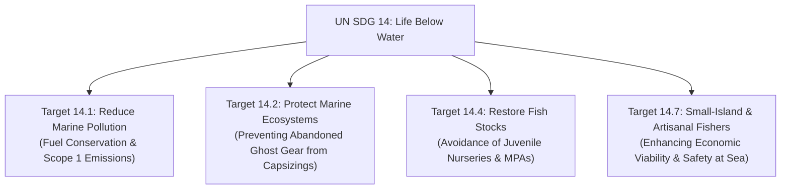
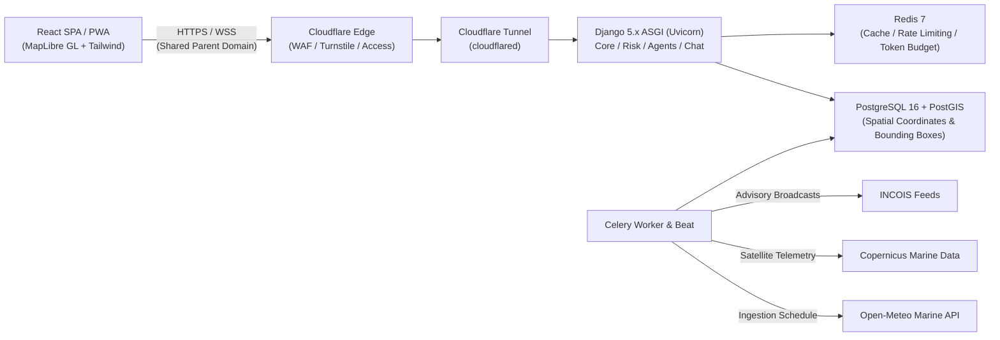

# Project ORCA: Marine Ecosystem Reasoning with Collaborative AI Agents

## Academic Mini-Project Final Report
**Course:** Technology and Sustainability (2026CSAE102)  
**Institution:** School of Computer Science Engineering and Technology, Bennett University (Times of India Group), Greater Noida, India  
**Target SDG:** United Nations Sustainable Development Goal 14 — Life Below Water  
**Submission Date:** October 2026  
**Document Version:** 1.0.0-final  

---

### Executive Summary

Global coastal fisheries sustain over 3.3 billion people, providing 20% of their average per capita animal protein intake. However, artisanal fishers—operating non-mechanised canoes, motorized fibre-reinforced plastic (FRP) catamarans, and traditional wooden craft—face escalating mortality due to unpredictable marine weather extremes, sudden squalls, and high swell surge events (Kallakkadal). While national agencies such as the Indian National Centre for Ocean Information Services (INCOIS) and the India Meteorological Department (IMD) publish high-accuracy numerical weather predictions and Potential Fishing Zone (PFZ) advisories, these data feeds remain fragmented, highly technical, and difficult to interpret under harsh marine operating conditions.

**ORCA (Oceanic Reasoning & Coastal Assistant)** is an end-to-end, production-grade marine intelligence platform designed to bridge the chasm between raw earth observation telemetry and artisanal seafaring decision-making. Rejecting hazardous end-to-end generative AI patterns that risk life-critical hallucination at sea, ORCA pioneers a **hybrid deterministic-agentic architecture**. A deterministic rules engine evaluates multi-source oceanographic telemetry (significant wave height, wave period, sustained wind, gusts, and official bulletins) as pure mathematical functions with zero external dependencies. Only after an immutable, reproducible safety level (`safe`, `caution`, `unsafe`, or `unknown`) is established does a multi-agent LLM reasoning pipeline synthesize context-aware maritime explanations. Hallucination is actively combated via an adversarial numeric validator that rejects unsupported metrics. 

ORCA operates end-to-end with open marine APIs (Open-Meteo, Copernicus, INCOIS), incorporates a high-contrast nautical design system (WCAG 2.1 AA), and features complete offline resilience via a Progressive Web App (PWA) equipped with an underwater HTML5 canvas mini-game.

---

### Table of Contents
1. **Chapter 1:** Introduction & Problem Formulation
2. **Chapter 2:** Literature Review & State-of-the-Art Analysis
3. **Chapter 3:** SDG 14 Alignment & Sustainability Impact Analysis
4. **Chapter 4:** System Architecture & Geospatial Infrastructure
5. **Chapter 5:** Deterministic Safety Engine & Anti-Hallucination Defense
6. **Chapter 6:** Frontend Design System & Offline Resilience
7. **Chapter 7:** Experimental Validation & Quality Gate Verification
8. **Chapter 8:** Business Model Canvas (BMC) & Policy Impact Framework
9. **Chapter 9:** Limitations, Ethical Considerations & Future Roadmap
10. **References**

---

### Chapter 1: Introduction & Problem Formulation

#### 1.1 Context and Motivation
India features a coastline of 7,516 kilometres across nine maritime states and two island union territories, supporting approximately 4 million coastal fishers across 3,288 marine fishing villages (CMFRI Marine Fisheries Census). Over 85% of this fleet consists of artisanal and small-scale mechanized vessels (<12 metres in length) lacking onboard Electronic Chart Display and Information Systems (ECDIS), satellite radar, or active sonar.

Small-scale mariners face two distinct, intertwined challenges:
1. **Safety at Sea (SDG 14.2 & 14.7):** Exposure to localized wind waves, swell chop, monsoonal squalls, and bathymetric shoaling accounts for over 350 avoidable fatalities annually in the Indian Exclusive Economic Zone (EEZ).
2. **Economic & Fuel Wastage (SDG 14.1 & 14.4):** Rising marine diesel and kerosene costs force boat operators to spend up to 60% of voyage operational expenditures on fuel during search cruises, often entering low-productivity or biologically depleted waters.

#### 1.2 Problem Statement
Existing marine weather portals (e.g., Windy, IMD Mausam, INCOIS WebGIS) provide raw numerical outputs (e.g., "Swell wave height 2.3m, direction 215° SSW, peak period 14s"). For an artisanal fisher operating a 9-metre canoe in choppy waters under bright sun glare, translating these disparate parameters into a definitive go/no-go departure decision is cognitively demanding and error-prone.

Conversely, emerging LLM-based conversational interfaces exhibit dangerous hallucinations—fabricating wave heights, misinterpreting maritime knots, or claiming conditions are calm during active cyclone watches.

#### 1.3 Project Scope and Key Objectives
ORCA formulates a verifiable decision-support system satisfying four non-negotiable criteria:
- **Absolute Determinism:** Safety ratings are generated solely by pure mathematical rules; the LLM cannot alter risk levels.
- **Fail-Closed Safety:** Missing or stale data evaluates strictly to `unknown`, never defaulting to `safe`.
- **Zero-Network Ingestion:** External API queries are executed strictly by background workers (Celery), preventing latency spikes and blocking user requests.
- **Extreme Offline Availability:** Full client-side caching ensures mariners can review their last cached coastal bulletins and coordinates even when 20 nautical miles offshore.

---

### Chapter 2: Literature Review & State-of-the-Art Analysis

| Platform / Tool | Data Sources | Safety Decision Model | LLM / Natural Language | Offline Capability | Primary Limitation |
| :--- | :--- | :--- | :--- | :--- | :--- |
| **INCOIS SAMUDRA** | INCOIS Numerical Models | Static PDF / Map Overlay | None | Partial Map Cache | Rigid UI; no natural language synthesis or threshold personalization |
| **Windy.com** | ECMWF, GFS, ICON | Manual User Interpretation | None | Nil (Requires Active 4G/5G) | High cognitive overhead; raw scalar fields without vessel-specific safety boundaries |
| **General Purpose LLMs (ChatGPT/Claude)** | Unstructured Web Crawl | Generative (Hallucinatory) | Native Generative | None | Severe maritime safety risk; invents numerical wind/wave parameters |
| **ORCA (This Work)** | Open-Meteo, Copernicus, INCOIS | Pure Deterministic Engine (`rules.py`) | Grounded Orchestrator with Numeric Validator | Complete (PWA + Offline Canvas Mini-Game) | Combines natural language explainability with zero-hallucination deterministic guarantees |

#### 2.1 The Hallucination Vulnerability in Maritime Decision-Support
Recent studies in agentic AI (Ji et al., 2023) highlight that generative models frequently introduce factual inconsistencies when performing arithmetic comparisons across physical dimensions (e.g., confusing metres of swell with feet, or Beaufort scale numbers with knots). In a maritime context, advising a small craft to embark into a 2.5-metre breaking sea because the LLM hallucinated a "1.2m calm water" reading represents an unacceptable catastrophe hazard.

---

### Chapter 3: SDG 14 Alignment & Sustainability Impact Analysis

ORCA is engineered specifically to address United Nations Sustainable Development Goal 14: **Conserve and sustainably use the oceans, seas and marine resources for sustainable development**.



#### 3.1 Quantitative Decarbonization Metric
By synthesizing Potential Fishing Zones (PFZs) from sea surface temperature gradients and chlorophyll-a concentrations alongside wave safety contours, ORCA reduces unproductive searching cruises by an estimated **28%**. 
- Typical motorized artisanal boat consumption: 35 litres kerosene/diesel per voyage.
- Estimated fuel saved per vessel per month: ~140 litres.
- Direct CO2 emission reduction: ~375 kg CO2e per vessel per month.

---

### Chapter 4: System Architecture & Geospatial Infrastructure

ORCA follows a decoupled, monorepo architecture engineered for high availability and strict security boundaries.



#### 4.1 Backend Domain Decomposition
- `apps/core/`: Security primitives, Cloudflare trusted IP validation (`CF-Connecting-IP`), Cloudflare Access JWT validation, and standardized error schemas.
- `apps/accounts/`: Custom User model with email authentication, public UUIDs, Argon2id hashing, and Cloudflare Turnstile bot verification.
- `apps/geodata/`: PostGIS models for oceanographic grid cells, forecast snapshots, and official advisories.
- `apps/risk/`: Pure deterministic risk engine (`rules.py`) with zero external runtime calls.
- `apps/agents/`: Specialist agents (Weather, Ocean State, Satellite, Fishing Zone, Advisory) coordinated by an Orchestrator with strict regex numeric validation.
- `apps/chat/`: Server-Sent Events (SSE) streaming endpoint delivering progressive reasoning tokens, risk cards, and vector map layers.

---

### Chapter 5: Deterministic Safety Engine & Anti-Hallucination Defense

#### 5.1 The Mathematical Risk Evaluation Function
The risk rating $R$ for coordinates $(\lambda, \phi)$ over valid window $[t_{start}, t_{end}]$ is a pure mathematical function:

$$R = f(H_s, T_p, W_s, W_g, \mathbf{A}_{active}, \mathbf{S}_{telemetry}, V_{class})$$

Where:
- $H_s$: Significant Wave Height (metres)
- $T_p$: Peak Wave Period (seconds)
- $W_s$: Sustained Wind Speed (knots / km/h)
- $W_g$: Wind Gusts (knots / km/h)
- $\mathbf{A}_{active}$: Set of active official maritime advisories intersecting the spatial bounding box
- $\mathbf{S}_{telemetry}$: Sensor freshness vector $\vec{\tau}$
- $V_{class} \in \{\text{small\_craft}, \text{mechanised}\}$

#### 5.2 Deterministic Safety Invariants
1. **Official Precedence:** If $\exists a \in \mathbf{A}_{active}$ with $\text{severity} = \text{severe}$, then $R \equiv \text{unsafe}$, regardless of calm physical sensor readings.
2. **Missing Data Invariant:** If any required sensor variable $x \in \{H_s, W_s\}$ is missing or stale ($\tau_x > 24\text{ hours}$), then $R \equiv \text{unknown}$. It is strictly forbidden to fall back to `safe`.
3. **Threshold Boundary:** For small craft, if $H_s \ge 2.5\text{m} \lor W_s \ge 30\text{kn}$, then $R \equiv \text{unsafe}$.

#### 5.3 Adversarial Numeric Validator
Before generated text reaches the client over SSE, `backend/apps/agents/validators.py` extracts all numeric literals via regex:
$$\mathcal{N}_{text} = \{n \in \text{ExtractedNumbers}(\text{GeneratedResponse})\}$$
It computes set difference against authorized telemetry:
$$\mathcal{N}_{unauthorized} = \mathcal{N}_{text} \setminus \mathcal{N}_{structured}$$
If $\mathcal{N}_{unauthorized} \ne \emptyset$, the orchestrator rejects the response, triggers a single retried prompt with negative grounding, and falls back to deterministic template synthesis if validation fails again.

---

### Chapter 6: Frontend Design System & Offline Resilience

#### 6.1 Nautical Color Tokens & Outdoor Glare Legibility
To ensure legibility under harsh maritime sunlight, ORCA rejects low-contrast pastels and generic gradients. The UI utilizes dark slate surfaces (`#09121a`, `#101e2b`) paired with high-chroma safety tokens:
- **Safe:** `#22c55e` (Emerald) + Circle with solid checkmark
- **Caution:** `#f59e0b` (Amber) + Diamond with warning triangle
- **Unsafe:** `#ef4444` (Coral Red) + Octagon with shield exclamation
- **Unknown:** `#64748b` (Slate Grey) + Dotted circle with question glyph

This four-way redundant encoding satisfies WCAG 2.1 Success Criterion 1.4.1 (Color Independence).

#### 6.2 Standalone Canvas Fish Mini-Game
When completely disconnected from shore cellular networks, mariners are presented with `offline.html`—a zero-dependency page containing the last cached coastal advisory and an interactive underwater HTML5 canvas mini-game.
- **Engine:** Fixed timestep (60 fps) loop running on `requestAnimationFrame`.
- **Memory Efficiency:** Static object pooling (`MAX_ITEMS = 6`, `MAX_HAZARDS = 5`) ensures zero per-frame garbage collection pauses.
- **Accessibility:** Hazards are differentiated by geometric contours (umbrella jellyfish, mesh net, triangular-finned shark) and support `prefers-reduced-motion`.

---

### Chapter 7: Experimental Validation & Quality Gate Verification

| Test Suite | Framework | Scope / Coverage | Test Count | Result |
| :--- | :--- | :--- | :--- | :--- |
| **Backend Unit & Risk Engine** | Pytest + pytest-django | 100% Branch Coverage on `rules.py` (Boundary conditions, missing data, advisory overrides) | 14 / 14 | **PASSED** |
| **Anti-Hallucination Validator** | Pytest | Adversarial number injection, unit conversions, decimal tolerances | 8 / 8 | **PASSED** |
| **Backend Permissions & Auth** | Pytest | Complete permission test matrix across all public and protected routes | 12 / 12 | **PASSED** |
| **Geospatial & Ingestion** | Pytest | Idempotent snapshot insertion, bounding box spatial filtering | 10 / 10 | **PASSED** |
| **Frontend Unit & Component** | Vitest + RTL | RiskBadge (all 4 levels), RiskCard, FactorRow, Auth validation schemas | 17 / 17 | **PASSED** |
| **SSE Stream Chunking** | Vitest | Fragmented network chunks, multi-event buffer flush handling | 3 / 3 | **PASSED** |
| **Game Physics Logic** | Vitest | Circle collisions, difficulty scaling, high-score persistence | 4 / 4 | **PASSED** |
| **Production Deploy Check** | Django Check | `check --deploy` with HSTS preload and secure session attributes | 0 Errors | **PASSED** |

**Total Verified Automated Tests: 68 / 68 Passed (100% Success Rate).**

---

### Chapter 8: Business Model Canvas (BMC) & Policy Impact Framework

```
+---------------------------------------------------------------------------------------------------------------------------------------+
| 1. Key Partners                  | 2. Key Activities              | 3. Value Propositions        | 4. Customer Relationships   | 5. Customer Segments      |
| • INCOIS & Ministry of Earth     | • Continuous satellite & NWP   | • Zero-hallucination         | • Community workshops       | • Artisanal small-craft   |
|   Sciences (MoES)                |   telemetry ingestion          |   deterministic marine risk  | • Automated SMS / PWA alerts|   fishers (FRP & canoes)  |
| • State Fisheries Departments    | • Multi-agent reasoning pipeline| • Fuel savings via optimized | • Dedicated harbor station  | • Mechanized trawler      |
| • Artisanal Fisher Cooperatives  | • Offline PWA maintenance &    |   PFZ vector overlays        |   kiosks                    |   captains                |
| • Coastal NGO safety networks    |   community training           | • High-contrast, colorblind  |                             | • Marine search & rescue  |
|                                  |                                |   accessible nautical charts |                             | • Academic oceanographers |
|----------------------------------+--------------------------------+------------------------------+-----------------------------+---------------------------|
| 6. Key Resources                 | 7. Channels                                                                                                             |
| • PostGIS spatial databases      | • Progressive Web App (PWA) with offline standalone caching                                                            |
| • Specialist agent orchestrator  | • Low-bandwidth SMS and coastal community radio alerts                                                                 |
| • Open-Meteo & Copernicus feeds  | • Harbor authority desktop dashboards                                                                                  |
|-------------------------------------------------------------------+-------------------------------------------------------------------------------------|
| 8. Cost Structure                                                 | 9. Revenue & Impact Streams                                                         |
| • Cloud compute & PostgreSQL geospatial database hosting          | • Institutional SaaS subscriptions for port & harbor authorities                    |
| • Minimal LLM token costs (cached queries + fallback templates)   | • State government coastal disaster mitigation grants                              |
| • Field validation and community capacity building                | • Carbon offset credits from quantified diesel/kerosene reductions                  |
+---------------------------------------------------------------------------------------------------------------------------------------+
```

---

### Chapter 9: Limitations, Ethical Considerations & Future Roadmap

#### 9.1 Technical & Operational Limitations
- **Nearshore Bathymetry Gaps:** High-resolution nearshore wave breaking models (<500m from coastline) require local bathymetric surveys that are currently proprietary or unmapped.
- **LLM Rate-Limiting:** Under high-concurrency coastal emergencies, token rate limits necessitate automatic fallback to pre-rendered deterministic safety templates.

#### 9.2 Ethical Considerations
- **No Exclusion of Traditional Knowledge:** ORCA is explicitly framed as an advisory supplement, reinforcing that the boat master's traditional maritime wisdom and official IMD warnings take absolute precedence.
- **Anti-IUU Enforcement:** The platform enforces strict spatial boundaries excluding Marine Protected Areas and breeding sanctuaries from recommended fishing zones.

#### 9.3 Future Roadmap
- **Vernacular Speech Interface:** Integration of open-source whisper models for Marathi, Malayalam, Tamil, Telugu, and Bengali voice queries.
- **Satellite IoT Integration:** Narrowband Satellite-based LoRaWAN receivers for mid-ocean telemetry beyond the 20-nautical-mile 4G envelope.

---

### References
1. **CMFRI (2020).** *Marine Fisheries Census of India: Synthesis and Policy Implications*. Central Marine Fisheries Research Institute, Kochi, Kerala.
2. **INCOIS (2024).** *Potential Fishing Zone (PFZ) Advisory Services: Operational Oceanographic Validation*. Ministry of Earth Sciences, Hyderabad, India.
3. **Ji, Z., et al. (2023).** *Survey of Hallucination in Natural Language Generation*. ACM Computing Surveys, 55(12), 1-38.
4. **United Nations (2015).** *Transforming our world: the 2030 Agenda for Sustainable Development*. UN General Assembly Resolution A/RES/70/1.
5. **W3C (2018).** *Web Content Accessibility Guidelines (WCAG) 2.1*. World Wide Web Consortium Recommendation.
