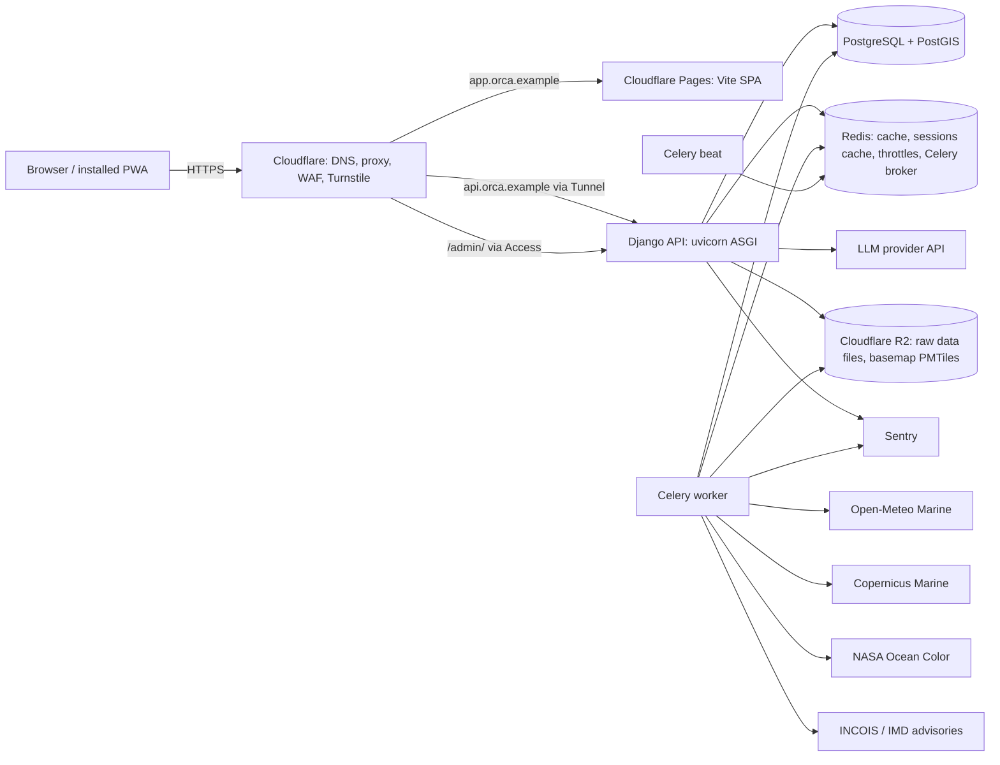

# Architecture

## 1. Assumptions

- Stage: MVP, built for demonstration, designed so it can become a live service.
- Region: Indian coastline first. Global data sources are used where they cover it.
- Scale: around 1,000 users, one region, low cost.
- Users are on phones with unreliable coastal connectivity.
- MVP login is email and password. Phone OTP is in `roadmap.md`.
- MVP language is English. The frontend is i18n-ready. Hindi and regional languages are in `roadmap.md`.
- Guests can chat with strict rate limits. Accounts add saved locations, alerts and history.

## 2. System diagram



Request path for a chat question:

1. Browser posts a message to `POST /api/v1/chat/threads/{id}/messages/`.
2. Django checks session, throttle and the global LLM budget.
3. The orchestrator asks the LLM to extract intent (location, date, vessel class, question type) as structured output.
4. Agents run as plain Python functions against **already ingested data** in Postgres. No agent calls an external data API during a user request.
5. The rules engine computes the risk level from agent outputs.
6. The LLM writes a short explanation from the structured results. A validator rejects any explanation containing a number that is not in the results.
7. The response streams to the browser as Server-Sent Events: status steps, the risk card, map layers, then text tokens.

## 3. Key decisions

| Decision | Choice | Why | Tradeoff |
|---|---|---|---|
| Frontend framework | Vite + React SPA | Django owns server logic. Map and PWA need client control. Next.js server features would duplicate Django. | Weak SEO outside the landing page, which is prerendered. |
| Backend host | Docker Compose on an India-region VPS behind a Cloudflare Tunnel | Cheapest. PostGIS, Redis and Celery fit on one host. Lowest latency to users. No open inbound web ports. | You operate the OS, backups and upgrades. |
| Process model | uvicorn (ASGI) for the API | SSE streaming needs async-capable serving. | Sync DRF views run in a threadpool. Keep the SSE view the only async view. |
| Agents | Plain Python functions with typed outputs, orchestrated by our own loop | Testable. No hidden control flow. No framework dependency. | We write the orchestration. It is about 300 lines. |
| Safety decision | Deterministic rules engine | An LLM must not decide who goes to sea. | Thresholds need expert validation. |
| Data access at request time | Ingest on a schedule, read from Postgres | Fast, cheap, resilient to provider outages, auditable. | Data is as old as the last ingestion. We show the age. |
| Geo | PostGIS via `django.contrib.gis` | Point-in-polygon, nearest cell, bounding box queries. | Docker image needs GDAL and GEOS libraries. |
| API | REST + OpenAPI via drf-spectacular, URL versioned `/api/v1/` | Typed client generation. | SSE endpoint is the one non-REST exception. |
| Basemap | Self-hosted PMTiles on R2 with MapLibre GL | No per-request tile server. Works with HTTP range requests. Cacheable offline. | Needs a one-time extract of India coast tiles. Verify extract tooling and licence. |

## 4. Data sources

All access and licence terms must be verified before use. None of this is confirmed for commercial use.

| Need | Candidate source | Notes to verify |
|---|---|---|
| Wind, rain, wave height, wave period, swell | Open-Meteo (Forecast and Marine APIs) | Free tier is for non-commercial use. Check terms and rate limits. |
| Ocean currents, sea surface temperature, chlorophyll (model and satellite products) | Copernicus Marine Service (`copernicusmarine` Python toolbox) | Needs an account. Check product IDs, resolution, update frequency for the Indian Ocean. |
| Chlorophyll, SST from satellites | NASA Ocean Color / Earthdata | Needs Earthdata login. Cloud gaps are common. |
| Official warnings, ocean state forecast, potential fishing zone (PFZ) advisories | INCOIS, IMD | May not offer a stable public API. Fallback is scheduled scraping of public pages or manual upload through the admin. Respect robots.txt and terms. |

Each source has an adapter in `apps/geodata/sources/<name>.py` implementing one interface:

```python
class SourceAdapter(Protocol):
    slug: str
    def fetch(self, since: datetime) -> Iterable[RawRecord]: ...
    def normalise(self, raw: RawRecord) -> Iterable[NormalisedRecord]: ...
```

Every ingestion run updates `DataSource.last_success_at` and `last_error`. The UI shows data age per source on the risk card.

## 5. Django project layout

```
backend/config/
  settings/base.py, dev.py, prod.py, test.py
  urls.py, asgi.py, wsgi.py, celery.py
backend/apps/
  core/        TimeStampedModel, PublicIdModel, exceptions, pagination, request-id middleware,
               cloudflare.py (trusted IP + Access JWT), health views
  accounts/    User, auth views, serializers, turnstile.py, throttles.py, tokens.py
  geodata/     DataSource, GridCell, ForecastSnapshot, Advisory, sources/, tasks.py, services.py
  risk/        rules.py (pure functions), thresholds.py, models.py (RiskAssessment), services.py
  agents/      orchestrator.py, llm.py, schemas.py, validators.py, agents/{weather,ocean_state,satellite,fishing_zone,advisory}.py
  chat/        Thread, Message, views.py (SSE), services.py
  locations/   SavedLocation, AlertSubscription, tasks.py (alert evaluation)
  dashboard/   views.py (overview), services.py
  auditlog/    AuditEntry, admin mixin, signals-free helper log_action()
```

Rules: views call services. Services hold business logic. Models hold data and simple invariants. See `backend.md`.

## 6. Data model

All models inherit `TimeStampedModel` (`created_at`, `updated_at`). Models exposed to clients also have `public_id` (UUIDv4, unique, indexed). Integer primary keys are never exposed.

### accounts.User
| Field | Type | Notes |
|---|---|---|
| id | bigint PK | internal |
| public_id | UUID | unique |
| email | citext-like, lowercased, unique | login field |
| display_name | varchar(80) | |
| is_email_verified | bool | default false |
| preferred_units | enum(`metric`,`knots`) | default `metric` |
| default_vessel_class | enum(`small_craft`,`mechanised`) | nullable |
| is_active, is_staff, is_superuser | bool | Django standard |
| last_login | datetime | |

Email uniqueness is enforced case-insensitively with a unique index on `lower(email)`.

### geodata.DataSource
`slug` (unique), `name`, `last_success_at`, `last_error`, `last_error_at`, `expected_interval_minutes`, `is_enabled`.

### geodata.GridCell
`id`, `geom` (Point, SRID 4326), `resolution_deg`, unique on (`geom`, `resolution_deg`). GiST index on `geom`. Cells are created on demand during ingestion for the coastal bounding box.

### geodata.ForecastSnapshot
| Field | Type | Notes |
|---|---|---|
| cell | FK GridCell | |
| source | FK DataSource | |
| valid_time | datetime (UTC) | time the values apply to |
| issued_at | datetime | when the provider produced it |
| ingested_at | datetime | when we stored it |
| values | JSONB | keys like `wave_height_m`, `wave_period_s`, `wind_speed_kmh`, `wind_gust_kmh`, `sst_c`, `chlorophyll_mg_m3`, `current_speed_ms` |

Unique on (`cell`, `source`, `valid_time`, `issued_at`). Index on (`cell`, `valid_time`). Old rows are pruned by a Celery task after 14 days.

### geodata.Advisory
`public_id`, `source`, `external_id`, `headline`, `body`, `severity` (enum `info|watch|warning|severe`), `area` (MultiPolygon, SRID 4326), `issued_at`, `expires_at`, `source_url`, `content_hash`. Unique on (`source`, `external_id`, `content_hash`). GiST index on `area`. Index on (`expires_at`, `severity`).

### risk.RiskAssessment
`public_id`, `user` (nullable FK), `location` (Point), `vessel_class`, `valid_from`, `valid_to`, `level` (enum `safe|caution|unsafe|unknown`), `factors` (JSONB), `advisory_ids` (JSONB list), `data_ages` (JSONB), `rules_version` (varchar), `thread_message` (nullable FK to chat.Message). Rows are immutable. They are the audit trail for every safety statement ORCA made.

### risk.FishingZone
`public_id`, `assessment` (FK), `geom` (Polygon or Point), `score` (0 to 100), `risk_level`, `factors` (JSONB), `origin` (enum `official_pfz|orca_heuristic`).

### chat.Thread
`public_id`, `user` (nullable FK), `session_key` (nullable, for guests), `title`, `last_message_at`. Check constraint: `user` or `session_key` is set.

### chat.Message
`public_id`, `thread` FK, `role` (`user|assistant`), `content` (text), `payload` (JSONB: risk card, map layers, tool trace summary), `llm_input_tokens`, `llm_output_tokens`, `model_id`. Index on (`thread`, `created_at`).

### locations.SavedLocation
`public_id`, `user` FK, `name`, `point` (Point), `kind` (`home_port|landing_site|custom`). Unique on (`user`, `name`). Limit 20 per user, enforced in the service.

### locations.AlertSubscription
`public_id`, `user` FK, `location` FK, `min_level` (`caution|unsafe`), `channel` (`email`), `is_active`, `last_notified_level`, `last_notified_at`.

### auditlog.AuditEntry
`created_at`, `actor` (nullable FK), `action` (varchar), `object_type`, `object_id`, `ip`, `request_id`, `changes` (JSONB). Append-only. No update or delete in admin.

## 7. Agents

Every agent has the signature `run(ctx: QueryContext) -> AgentResult`, where `AgentResult` is a Pydantic model with `data`, `data_age`, `sources`, `gaps`.

| Agent | Reads | Returns |
|---|---|---|
| weather | ForecastSnapshot (wind, gust, rain) | hourly wind and rain for the window, max values |
| ocean_state | ForecastSnapshot (wave height, period, swell, current) | wave and current summary, max values |
| satellite | ForecastSnapshot (chlorophyll, SST) + gap detection | bloom flag, SST gradient field, `gaps` where cloud or age blocks data |
| fishing_zone | Advisory (official PFZ), satellite output | ranked zones with `origin` |
| advisory | Advisory | active advisories intersecting the location and window |

`QueryContext` holds: point, window (`valid_from`, `valid_to`), vessel class, user units. Agents never read other agents' output directly. The orchestrator passes results to the rules engine.

## 8. Risk rules engine (`apps/risk/rules.py`)

Pure functions. No database access, no LLM, no clock reads inside rules. Input is a dataclass. Output is a `RiskResult`.

Algorithm:

1. For each factor (wave height, wind speed, gust, rain, active advisory), compare against thresholds for the vessel class. Each factor gets a level.
2. Overall level is the **worst** factor level.
3. If any required factor has no data, or its data is older than the maximum age, overall level is `unknown`. `unknown` is shown with the missing items listed.
4. An active `warning` or `severe` advisory covering the point forces `unsafe`.
5. Output includes every factor with value, unit, threshold crossed, source and observed time.

Thresholds live in `apps/risk/thresholds.py`, versioned by `RULES_VERSION`.

> **Placeholder values.** The numbers in `thresholds.py` at MVP are development placeholders. They must be reviewed and replaced by values from a qualified marine-safety source (INCOIS, state fisheries department, or a coast guard advisory) before any real-world use. Do not present them as official.

Example structure (values deliberately omitted here so they are not copied as fact):

```python
THRESHOLDS = {
    "small_craft": {"wave_height_m": Band(caution=..., unsafe=...), ...},
    "mechanised":  {"wave_height_m": Band(caution=..., unsafe=...), ...},
}
MAX_DATA_AGE_HOURS = {"wave_height_m": ..., "wind_speed_kmh": ..., "advisory": ...}
```

## 9. LLM usage

- Provider: configured by `LLM_PROVIDER` and `LLM_MODEL` env vars. Default planned provider is the Anthropic API. Verify current model names and pricing before choosing.
- Two calls per question: (a) intent extraction with a JSON schema, (b) explanation writing.
- Explanation validator: extract every number from the generated text and require each to appear in the structured results (after unit formatting). On failure, retry once, then fall back to a template-rendered explanation with no LLM text.
- Prompts live in `apps/agents/prompts/` as versioned files. Prompt text is never built from raw user input without delimiting it.
- User text is untrusted. It cannot change thresholds, tools or output schema.
- A global daily token budget (`LLM_DAILY_TOKEN_BUDGET`) is tracked in Redis. When exceeded, chat falls back to the structured risk card with template text and says so.

## 10. Caching

| What | Where | TTL |
|---|---|---|
| Risk assessment for (grid cell, window, vessel class) | Redis | 15 minutes, invalidated on ingestion of that cell |
| Advisory list for a bounding box | Redis | 5 minutes |
| Data status | Redis | 1 minute |
| Sessions | `cached_db` backend (Redis cache with database fallback) | session age |

Cache keys are prefixed `orca:v1:`. Bump the version to invalidate everything.

## 11. Rate limiting

DRF throttles on Redis. Numbers are starting points. Tune from logs.

| Scope | Limit |
|---|---|
| Login, signup, password reset (per IP) | 10 per hour |
| Login (per email) | 5 per 15 minutes |
| Chat messages, guest (per session and per IP) | 10 per hour |
| Chat messages, authenticated | 60 per hour |
| Read endpoints, authenticated | 120 per minute |
| Read endpoints, anonymous | 60 per minute |

Cloudflare WAF rate-limiting rules sit in front of these for `/api/v1/auth/` and `/api/v1/chat/`. See `deployment.md`.

## 12. Error handling

All API errors use one shape:

```json
{ "error": { "code": "rate_limited", "message": "Too many requests. Try again in 20 minutes.", "details": {}, "request_id": "01J..." } }
```

A custom DRF exception handler maps every exception to this shape. Root `handler404` and `handler500` return the same JSON for `/api/` paths. Unexpected errors go to Sentry with the request ID. The user sees a generic message.

## 13. Logging

`structlog` JSON logs to stdout. Every request gets a `request_id` (from `CF-Ray` if present, else generated). Logs never include passwords, tokens, session IDs, full emails or precise user coordinates. See `observability.md`.

## 14. Environments

| Env | Frontend | API | Data |
|---|---|---|---|
| local | `app.localtest.me:5173` | `api.localtest.me:8000` | Docker Postgres/Redis, seed data |
| staging | Pages preview or `staging.app.orca.example` | `staging-api.orca.example` | Separate DB, ingestion enabled with low frequency |
| production | `app.orca.example` | `api.orca.example` | Production DB, R2 bucket, backups |

## 15. Scaling and cost notes

- One VPS with 4 GB RAM or more can run API, worker, beat, Postgres, Redis and cloudflared for the MVP. Exact sizing comes from load tests, not guesses.
- First bottleneck is LLM latency and cost, not the database. Control with the token budget and the template fallback.
- Second is ingestion volume. Limit the bounding box and the number of variables. Prune old snapshots.
- When the VPS is outgrown: move Postgres to a managed PostGIS service first, then run the API on two hosts.
- Cloudflare Pages and R2 costs are low at this scale. Verify current pricing.

## 16. What ORCA does not do

- It does not give legal, navigational or search-and-rescue guidance.
- It does not replace radio, coast guard or official fisheries warnings.
- It does not guarantee catch.
- It does not store precise location history beyond what the user saves.
